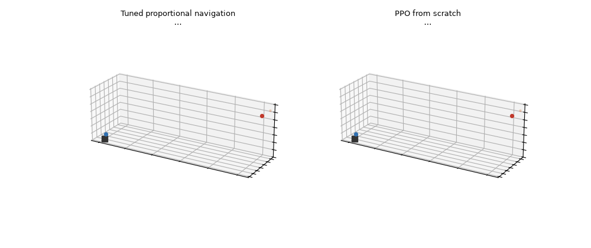
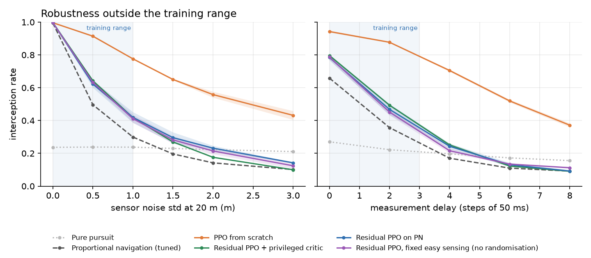
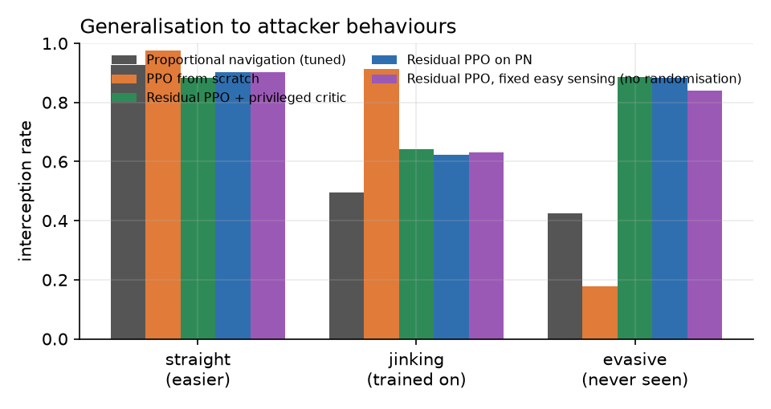
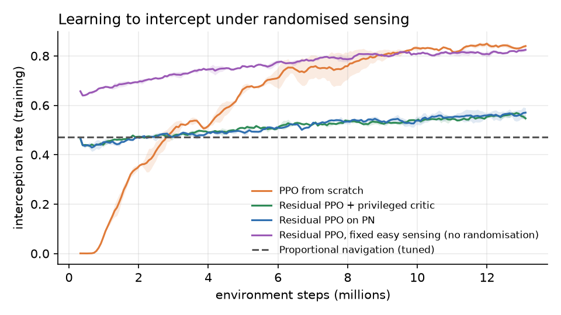
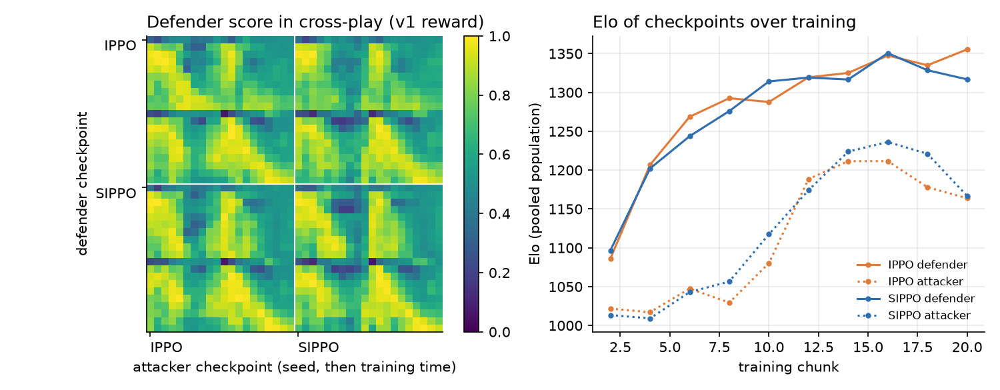

<div align="center">

# 🛡️ SkyGuard-RL

### Learning to intercept drones under imperfect sensing




*Same engagement, same attacker. Left: tuned proportional navigation loses the target under sensor noise. Right: the PPO interceptor catches it.*

</div>

An interceptor drone defends a ground asset against an attacker drone in a vectorised 3D simulator. It learns with **PPO** from **noisy, delayed, intermittent sensor tracks**. It is benchmarked against **tuned proportional navigation (PN)**, the classical missile-guidance law, and then trained against a **learning attacker** with asymmetric self-play.

> ### Key results
> | | Tuned PN | **PPO interceptor** |
> |---|---|---|
> | Interception under randomised sensing | 47% | **86%** |
> | At 3× the training noise | 10% | **43%** |
> | Ground crashes in the hard condition | 54% | **2–3%** |
>
> - **Robust to sensing ≠ robust to behaviour:** against an unseen evasive attacker, pure PPO drops to 18%, while a residual policy on top of PN keeps 88%.
> - **Self-play helps:** training against a learning attacker lifts the unseen-behaviour score from 18% to about 70%.
> - **Reward hacking, found twice:** the learned attacker stopped attacking and stalled. Even with equal penalties, discounting (γ = 0.99) made delay pay off.

**Contents:** [Why](#why-this-project) · [Simulator](#the-simulator) · [Experiment 1](#experiment-1-learned-guidance-vs-proportional-navigation) · [Experiment 2](#experiment-2-self-play-under-partial-observability) · [Reproduce](#reproduce) · [Limitations](#limitations) · [Next steps](#next-steps)

## Why this project

Recent work from ULiège and Belerion frames what is missing before RL controllers can be used for counter-drone defence:

- *Existing Gaps in RL for Drone Warfare* (Louette, Leroy, Geurts, Ernst, 2025) argues that **diversity of deployed conditions** is the axis to master first: *"if [it] is not mastered, a drone could be useless on the battlefield."*
- *Autonomous Drone Combat* (Hansen, Louette, Leroy, Ernst, 2025) shows that **asymmetric self-play (S-IPPO)** gives more robust defenders than independent PPO. It lists *partially observable settings* as future work.
- *Memory-State Critic* (Louette et al., EWRL 2026) studies **asymmetric actor-critic** when the actor only gets partial observations.

SkyGuard-RL is a small, fast testbed that asks three questions in that spirit:

1. Does a learned interceptor beat a tuned classical guidance law when sensing is degraded, and how far outside its training range does it hold up?
2. Does building on the classical law (a residual policy) help, or does it get in the way?
3. When the attacker also learns, does self-play against past opponents give more robust defenders under partial observability?

## The simulator

| Component | Model |
|---|---|
| Drones | 3D point masses commanded in acceleration through a first-order actuator lag (inner attitude loop abstracted, as in a cascaded controller). Defender: 14 m/s, 25 m/s². Attacker: 10 m/s, 15 m/s² |
| Engagement | Attacker spawns 40–55 m out at 10–25 m altitude and dives on an asset at the origin. Defender launches from the asset. Interception = closest approach under 1 m within a step (checked along the segment, so no tunnelling). Leak = attacker within 2 m of the asset. Crash = defender hits the ground or leaves the area |
| Sensing | The defender only gets relative-position measurements of the attacker, with **range-dependent Gaussian noise, measurement delay and dropouts**, filtered by an **α-β tracker** (gains tuned by grid search) |
| Domain randomisation | Every episode re-samples noise σ ∈ [0, 1] m (at 20 m), delay ∈ {0..3} steps, dropout ∈ [0, 0.2], actuator lag τ ∈ [20, 100] ms |
| Attackers | `straight`, `jink` (random 3D sinusoidal weaving, stronger when threatened), `evader` (breaks sideways away from the interceptor; never used in training), or a learned PPO policy |
| Speed | numpy-vectorised, about 450k env-steps/s on a laptop CPU |

The PPO network and hyperparameters follow Hansen et al. (2025): separate 256-128 ELU actor and critic, orthogonal init, state-independent log std, clip 0.2, entropy 0.001, KL-adaptive learning rate (threshold 0.008).

## Experiment 1: learned guidance vs proportional navigation

Defenders trained for 13M steps against jinking attackers under randomised sensing, 2 seeds each. Evaluated on 2,048 fresh engagements per condition, with deterministic actions.

| Interception rate | Pure pursuit | **Tuned PN** | **PPO from scratch** | Residual PPO on PN | Residual + privileged critic | Residual, no randomisation |
|---|---|---|---|---|---|---|
| Training conditions (randomised) | 24% | 47% | **86%** | 58% | 56% | 57% |
| Noise 3 m (3× training max) | 21% | 10% | **43%** | 14% | 10% | 12% |
| Delay 6 steps (2× training max) | 17% | 11% | **52%** | 13% | 12% | 14% |
| Hard: noise 2 m, delay 4, dropout 30% | 18% | 9% | **44%** | 12% | 10% | 12% |
| Crashes in the hard condition | 47% | 54% | **2–3%** | 18–31% | 15–20% | 31–53% |
| **Evasive attacker (never seen)** | 1% | 42% | 18% | **88%** | **89%** | 84% |




**What this shows**

- **The learned interceptor holds up far better under degraded sensing.** Classical PN collapses as soon as estimates get noisy or late, because it steers on the estimated line-of-sight rate, the noisiest quantity there is. PPO from scratch keeps 43–52% interception at two to three times the training noise or delay. PN drops to about 10% there. It also nearly stops crashing into the ground.
- **But it overfits to the opponent it trained against.** Against the unseen evasive attacker, PPO from scratch drops to 18%, below PN. Robustness to *sensing* does not imply robustness to *behaviour*.
- **The classical prior is what generalises to new behaviour.** The residual policy can only adjust PN, so it inherits PN's weakness to noise, but it keeps PN's geometry: 88% against the evasive attacker. Each design is good on a different axis, which is the gap self-play is meant to close (experiment 2).
- **The privileged critic** (true state and hidden simulator parameters, training only) made no measurable difference to interception rate here, with slightly fewer crashes in hard conditions. A likely reason: the actor's observation already holds the tracker's state, an explicit memory, so the critic has little to gain. This is consistent with the memory-state critic argument.
- **Domain randomisation** mattered little for the residual's interception rate, but without it the policy crashed much more in hard conditions (31–53% vs 18–31%).



## Experiment 2: self-play under partial observability

Both drones learn at once. The defender has the same randomised noisy sensing as in experiment 1; the attacker sees perfectly. **IPPO** (both learn independently) is compared with **S-IPPO** (Hansen et al., 2025): at the start of each 10-iteration chunk, with probability 0.2 the defender trains against a frozen past attacker. 20 chunks (13M steps), 2 seeds per method. Every second checkpoint of every run was cross-played against every other (40 × 40 pairs, 128 engagements each) and rated with Elo as in the paper.

> With **perfect sensing** the game is not a game: the faster defender intercepted 88–99% and the attacker learned nothing, so partial observability was required to get competitive dynamics.



**Results**

| | IPPO | S-IPPO |
|---|---|---|
| Final defender Elo (2 seeds) | 1399, 1312 | 1325, 1308 |
| Mean defender score vs all 40 attacker checkpoints | 0.69 | 0.69 |
| **Final defender vs the unseen evasive scripted attacker** | 83%, 65% | 85%, 48% |

1. **Training against a learning opponent fixes much of the behaviour overfitting.** Experiment 1's PPO defender, trained only against jinking attackers, caught the evasive attacker 18% of the time. Self-play defenders catch it 48–85% (about 70% on average).
2. **IPPO vs S-IPPO is a tie at this scale.** The paper's advantage appeared over 1 billion steps and 100 checkpoints; 13M steps and 2 seeds are not enough to separate them.
3. **Reward hacking, twice.**
   - **v1:** the attacker got −5 for a timeout but −10 for being intercepted. After about 8 chunks it stopped attacking (0% leaks) and learned to evade until the clock ran out. Attacker Elo peaks at chunk 14–16, then falls.
   - **v2:** I made a timeout cost −10, the same as an interception. It still stalls: 77–94% timeouts. With γ = 0.99, a −10 that arrives 300 steps later is worth about −0.5 now (0.99³⁰⁰ ≈ 0.05), while being caught soon costs about −6. Discounting makes delay rational.
   - **Lesson:** equal terminal penalties do not encode the mission. Stalling has to count as a defender win, or the attacker needs time pressure (a per-step cost or a deadline tied to its goal).

| Outcome at the final checkpoint (1,024 games) | Intercept | Leak | Defender crash | Timeout |
|---|---|---|---|---|
| v1 IPPO / S-IPPO | 33–81% | 0–4% | 1–14% | 2–59% |
| v2 IPPO / S-IPPO | 5–39% | 0% | 0–10% | 51–94% |

## Reproduce

```bash
python -m venv .venv && .venv/Scripts/pip install -r requirements.txt   # CPU is enough
./run_exp1.sh                       # 8 runs, ~35 min on a 12-thread laptop
python evaluate_guidance.py         # -> results/guidance_eval.json
./run_exp2.sh                       # 4 self-play runs (v1 reward)
./run_exp2_v2.sh                    # 4 self-play runs (v2: timeout costs the attacker -10)
python evaluate_selfplay.py --out results/selfplay_v1_eval.json   # cross-play, Elo, scripted tests
python make_figures.py
python render_demo.py --policy runs/guid_direct_dr-full_sh0.1_sym_s0.pt
```

## Limitations

- Point-mass dynamics with a lag model, not a quadrotor with thrust and torques. That is a deliberate abstraction (high-level action, control loop underneath) that makes the testbed run on a laptop, but sim-to-real conclusions need a quadrotor simulator such as IsaacLab.
- 13M training steps and 2 seeds per configuration. Differences of a few points are within noise; the large gaps (2–4×) are well beyond the seed-to-seed spread.
- Three scripted attacker behaviours are a small behaviour set.
- Self-play ran 13M steps with 2 seeds per method, far below the paper's 1B steps, so the IPPO vs S-IPPO comparison is inconclusive.
- The residual policy's correction is bounded (scale 0.5 on a saturated PN command), which limits how far it can move away from PN. A larger scale or a learned blend is the obvious next step.

## Next steps

1. **Give the attacker a real mission** (stalling counts as a defender win, or a deadline) so self-play produces attackers that actually attack. Then compare IPPO vs S-IPPO with more seeds and steps.
2. Replace the α-β tracker with a **recurrent actor** and compare critics: state only, history-state, **memory-state**.
3. Move to **IsaacLab with Crazyflie dynamics** and actuator-level actions.
4. Scale to **saturation attacks** (N attackers vs M interceptors) and compare **CTDE (MAPPO) vs IPPO**.
